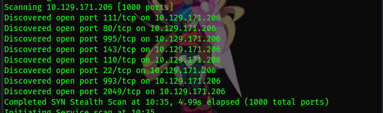
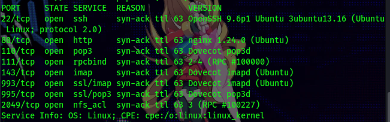

# NMAP

### Escaneo con Nmap y descubir los puertos abiertos



### Servicios descubriertos 



- La presencia de POP3, IMAP (normal y tls), indica que muy probablemente el objetivo tenga una infraestructura de e-mail, ademas de tener un servidor nfs el cual llama mucho la atencion, ya que al este no estar bien configurado puede exponer archivos o directorios a usuarios no autorizados.

# NFS
  
  - Ejecute: `showmount -e [ip destino]` para mostrar la lista de todos los directorios que el servidor está compartiendo y qué IPs tienen permiso para verlos.


lo del final nos indica que cualquier ip puede verlos
 
- Montare la carpeta y reviso el contenido:

```
$ mkdir /tmp/nfs_results
$ sudo mount -t nfs [IP destino]:[Directorio] -o nolock
$ ls -la /tmp/nfs_results
```


un .pdf lo abro con `pdftotext [Archivo]-` para ver que contiene 


# Webmail

Entro al webmail y vemos otro usuario llamado sarah, asi que pruebo entrar a ese usuario con la misma password, funciona y veo lo siguiente


ingreso a la URL y vemos que es un dashboard de OpenSTAManager, toco el perfil y miro que es la version 2.9.8, investigo y veo que esa version es vulnerable (**CVE-2026-38751**) 

# Acceso inicial

Yo use el exploit de https://github.com/b0ySie7e/OpenSTAManager-RCE-Exploit-CVE-2026-38751


whoami para ver el usuario actual 


hago una observacion del archivo `config.inc.php`


# Login into MySQL

Logeo con las credenciales encontradas y miro la bases de datos


y ahora con selecciono `openstamanager`, observo las tablas, me encuentro con zz_users y miro el contenido de ello  


# Cracking usando John o Hashcat

la contraseña de Haris esta hasheada con bcrypt, asi que puede crackearse con john o hashcat


el Resultado da `bestfriends`, ya tengo acceso a la primera flag


# Ganar Acceso SSH 

ya estoy dentro pero seria mejor y mas comodo tener acceso por ssh asi que creo la ssh key en mi maquina local y la añado a la maquina (haris)

- Una vez finalizado accedere mediante ssh


# Escalar Privilegios

ahora observare com `ss -tulpn` para ver los servicios y aplicaciones y noto que `127.0.0.1:1337` esta escuchando solo en localhost, envio un `$ curl -s` y encuentro que esta corriendo una aplicacion llamada OliveTin y checkeo el proceso, esta corriendo como root


activo un autossh para poder ingresar al OliveTin mediante la web, observo la version `OliveTin 3000.10.0` que es vulnerable a **CVE-2026-27626**

Utilizo el Exploit publico de https://github.com/0xh7ml/CVE-2026-27626-PoC, consigo acceso a root y obtengo la flag


